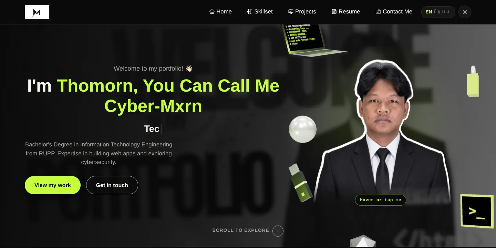
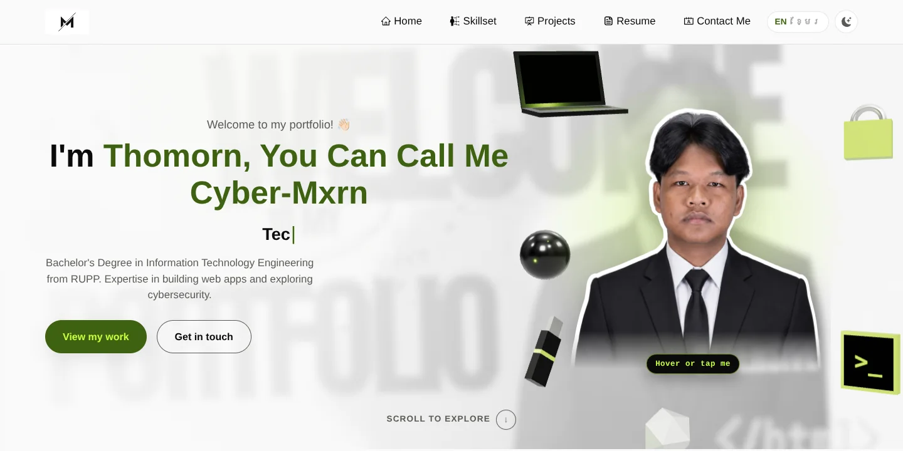
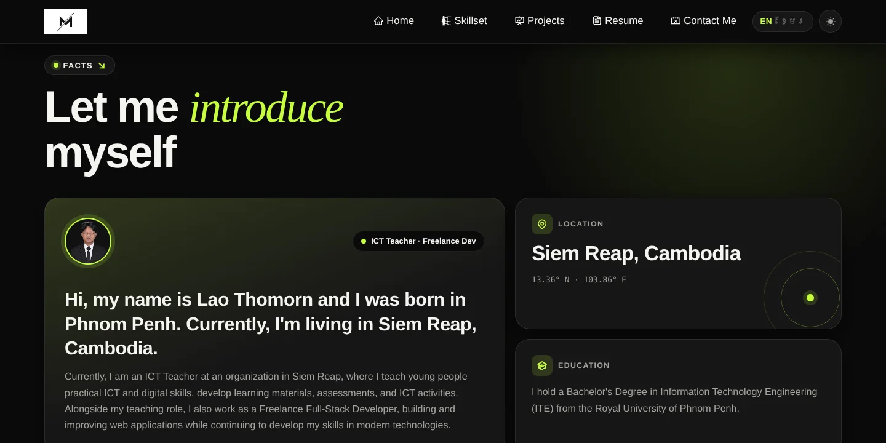

<div align="center">

<a href="https://myportfolio-7s0.pages.dev/">
  
</a>

<br />


<br />

<a href="https://myportfolio-7s0.pages.dev/"></a>
<a href="https://github.com/Mxrn-Cyber/my_portfilio/stargazers"></a>


<br /><br />

**[Live demo](https://myportfolio-7s0.pages.dev/)** · **[Features](#-features)** · **[Quick start](#-quick-start)** · **[Customize](#-customize)** · **[Deploy](#-deploy)**

</div>

<br />

## 🖥️ Preview

<p align="center">
  
</p>

<table>
  <tr>
    <td width="50%"></td>
    <td width="50%"></td>
  </tr>
  <tr>
    <td align="center"><sub><b>Light mode</b></sub></td>
    <td align="center"><sub><b>Bento-grid About section</b></sub></td>
  </tr>
</table>

<br />

## ✨ Features

<table>
  <tr>
    <td width="50%" valign="top">
      <h4>🧊 3D hacking-tools hero</h4>
      A three.js scene with a laptop running a live terminal, a padlock, a USB stick and a <code>&gt;_</code> tile. It follows your mouse and scroll.
    </td>
    <td width="50%" valign="top">
      <h4>🕶️ Hacker mode</h4>
      Hover or tap the portrait and it opens into a hooded-hacker avatar with glowing code glasses.
    </td>
  </tr>
  <tr>
    <td valign="top">
      <h4>🌗 Lime on black</h4>
      Light and dark themes from one set of color tokens. The site matches your OS setting and remembers your choice.
    </td>
    <td valign="top">
      <h4>🇰🇭 English + Khmer</h4>
      Every line of text is translated, and you can switch language with one tap.
    </td>
  </tr>
  <tr>
    <td valign="top">
      <h4>🍱 Modern sections</h4>
      Bento-grid About with a cursor spotlight, a scrolling Focus list, 3D-tilt project cards and a live Siem Reap clock.
    </td>
    <td valign="top">
      <h4>🔎 SEO-ready</h4>
      Every route is pre-rendered with its own title, description, Open Graph tags and structured data. A sitemap is built automatically.
    </td>
  </tr>
  <tr>
    <td valign="top">
      <h4>⚡ Fast by default</h4>
      three.js loads lazily, animations pause when off screen, and a "lite" mode turns on automatically for weak GPUs.
    </td>
    <td valign="top">
      <h4>♿ Accessible</h4>
      Keyboard-friendly controls and alt text on images. All motion respects <code>prefers-reduced-motion</code>.
    </td>
  </tr>
</table>

<br />

## 🧰 Tech stack

<p align="center">
  
</p>

| Layer       | Tools                                                         |
| :---------- | :------------------------------------------------------------ |
| Framework   | React 18 · Create React App · React Router 6                  |
| Styling     | React-Bootstrap · custom CSS design tokens                    |
| Motion & 3D | three.js · react-parallax-tilt · tsparticles · typewriter-effect |
| Content     | react-pdf (resume viewer) · react-helmet-async (SEO)          |
| Contact     | Web3Forms                                                     |
| Hosting     | Cloudflare Pages · GitHub Actions                             |

<br />

## 🚀 Quick start

> Requires **Node.js 18+**

```bash
git clone https://github.com/Mxrn-Cyber/my_portfilio.git
cd my_portfilio
npm install
npm start
```

Open **http://localhost:3000**.

| Command         | Description                                                      |
| :-------------- | :--------------------------------------------------------------- |
| `npm start`     | Dev server with hot reload                                       |
| `npm run build` | Production build, then pre-renders every route and writes the sitemap |
| `npm test`      | Runs the tests                                                   |

> [!TIP]
> To force a performance mode while testing, add `?perf=full` or `?perf=lite` to the URL.

<br />

## 🗂️ Project structure

<details>
<summary><b>Show the folder tree</b></summary>

```text
.
├── docs/                    # README banner + screenshots
├── public/
│   ├── index.html           # base HTML, meta tags, structured data
│   └── hacker-avatar.svg    # animated hover avatar
├── scripts/
│   └── prerender.js         # post-build: per-route HTML + sitemap.xml
└── src/
    ├── pages/               # Home · Skillset · Projects · Resume · Contact
    ├── components/
    │   ├── Home/            # Hero3D · HeroSwap · Focus · About · Type
    │   ├── Common/          # Reveal (scroll animation) · SectionLabel
    │   └── Navbar/ Footer/ Projects/ Skillset/ Contact/
    ├── context/             # ThemeContext · LanguageContext
    ├── translations/        # en.js · km.js (all page text)
    ├── seo/                 # siteConfig.js · Seo.jsx
    ├── perf.js              # weak-GPU detection ("lite" mode)
    └── style.css            # design tokens + main styles
```

</details>

<br />

## 🎨 Customize

| To change…     | Edit                                                                    |
| :------------- | :---------------------------------------------------------------------- |
| Text (EN / KM) | `src/translations/en.js` · `src/translations/km.js`                     |
| Colors         | the tokens at the top of `src/style.css` (`--accent`, `--bg`, …)        |
| Projects       | the list in `src/pages/Projects.jsx` and `projects.items` in the translation files |
| SEO / domain   | `src/seo/siteConfig.js` (change `SITE_URL` for a custom domain)         |
| Resume         | replace `src/assets/Lao-Thomorn-CV.pdf`                                 |

<br />

## ☁️ Deploy

Every push to `main` runs `.github/workflows/deploy.yml`, which builds the site and publishes `build/` to **Cloudflare Pages**.

Add these two repository secrets first:

```text
CLOUDFLARE_API_TOKEN
CLOUDFLARE_ACCOUNT_ID
```

<br />

## 👋 Author

<div align="center">

**Lao Thomorn — Mxrn Cyber**
<br />
<sub>Full-Stack Web Developer · UI/UX Designer · ICT Teacher · Siem Reap, Cambodia</sub>

<br /><br />

<a href="https://github.com/Mxrn-Cyber"></a>
<a href="https://www.linkedin.com/in/lao-thomorn-347a4b28b/"></a>
<a href="https://www.figma.com/@CyberMorn"></a>
<a href="https://x.com/cybermorn"></a>

<br /><br />

<sub>If this project helped or inspired you, leave a ⭐ — it means a lot.</sub>

</div>
